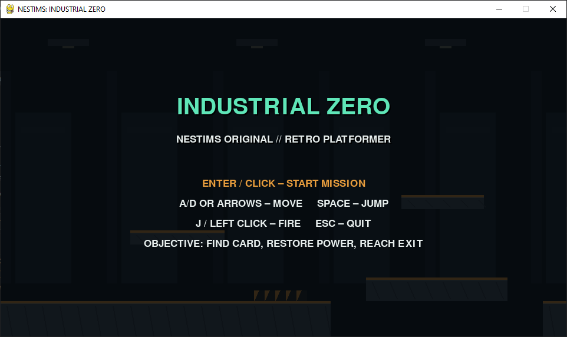
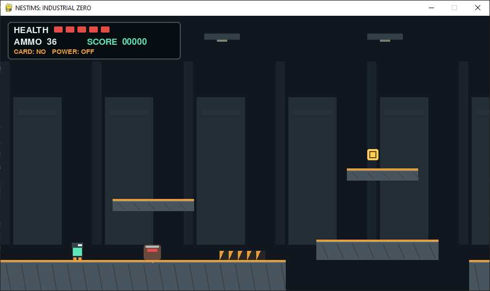
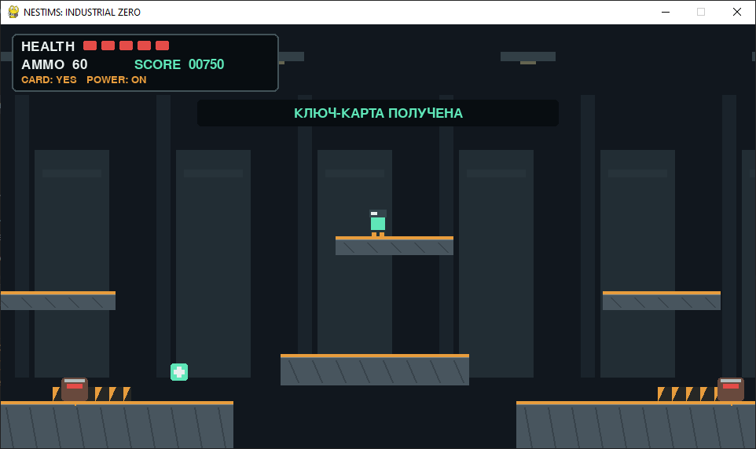
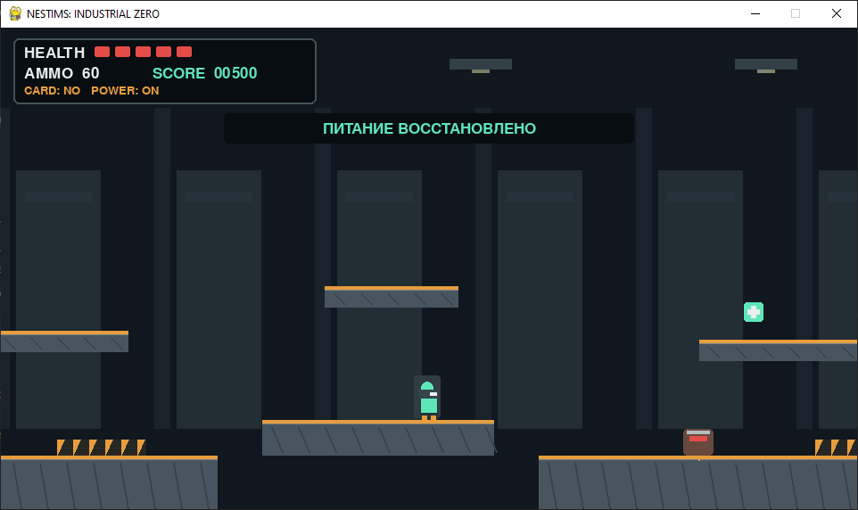
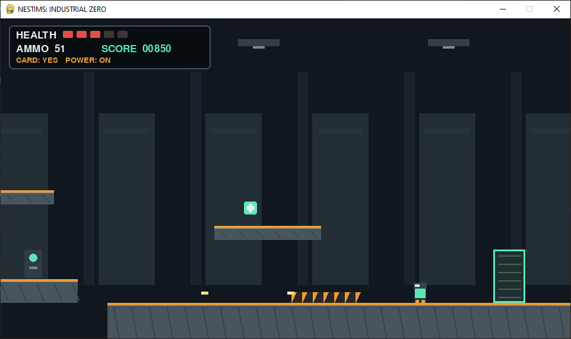
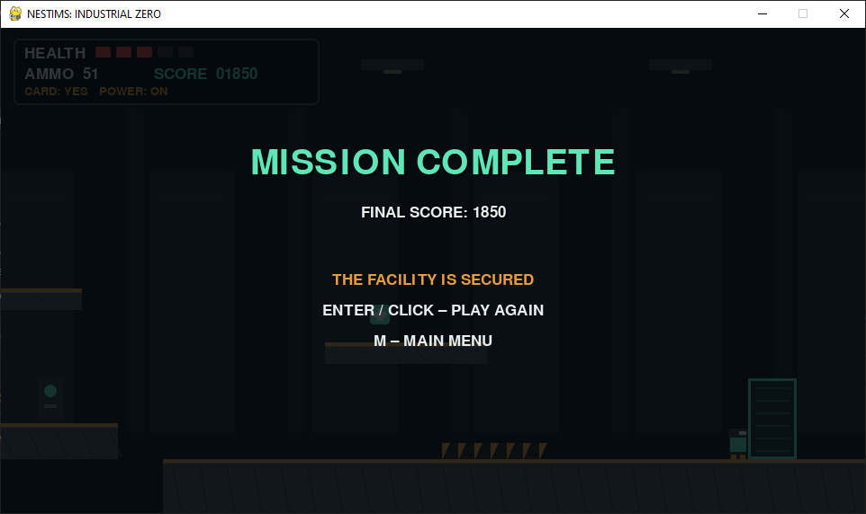
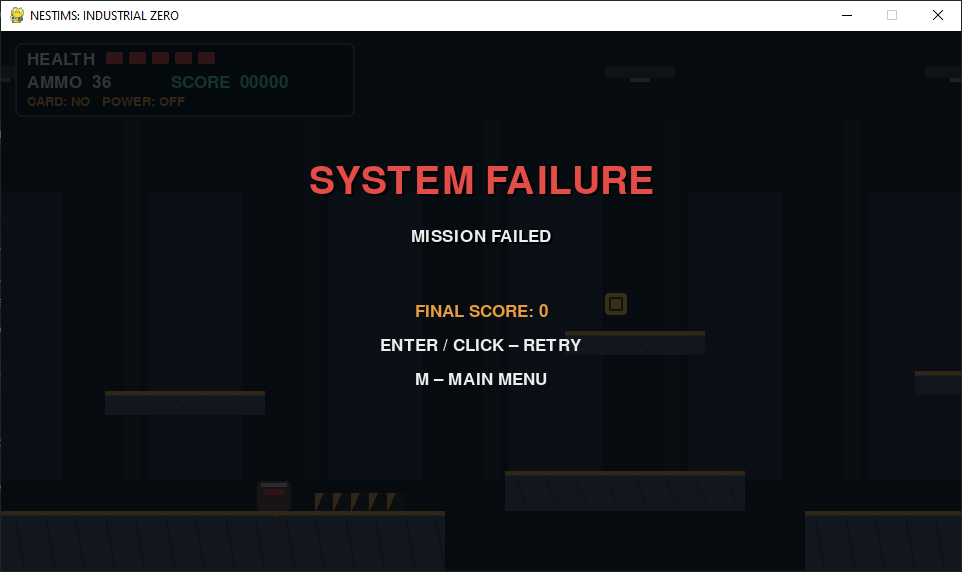

# Industrial Zero (Hunter Mike)

> 2D platformer inspired by Dangerous Dave (1991).

## 💻 Project Run
- Open with Python: [Industrial_Zero.py](Industrial_Zero.py)

- Or download exe: [Industrial_Zone.exe](https://github.com/NebulaStack-prog/Hunter-Mike/releases/tag/v1.0.0)

## 📄 Full documentation
- 🇷🇺  Russian version: [Documentation](IZ_RU.md)
  
- 🇺🇲  English version: [Documentation](IZ_EN.md)

## 📷 Screenshots

 
© NESTIMS
