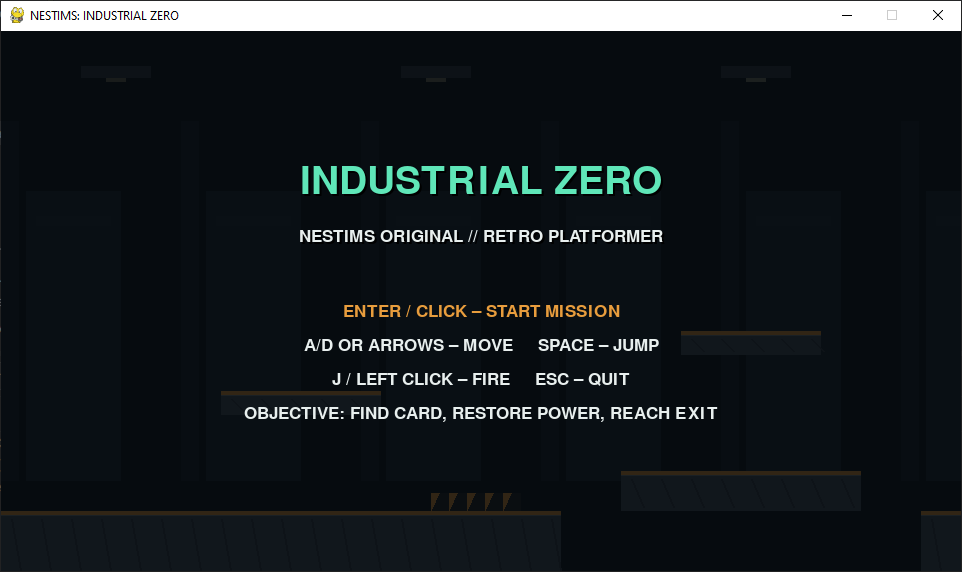
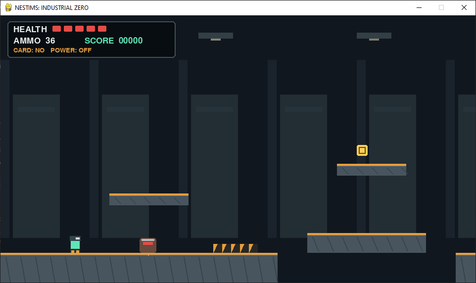
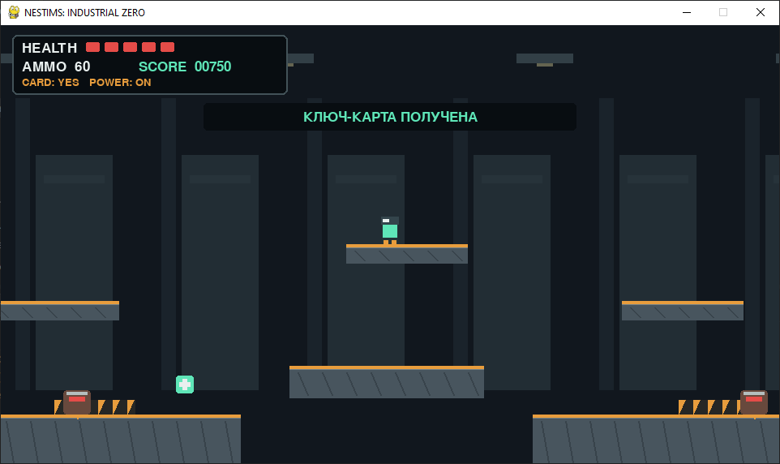
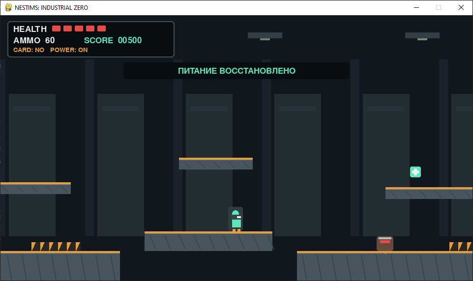
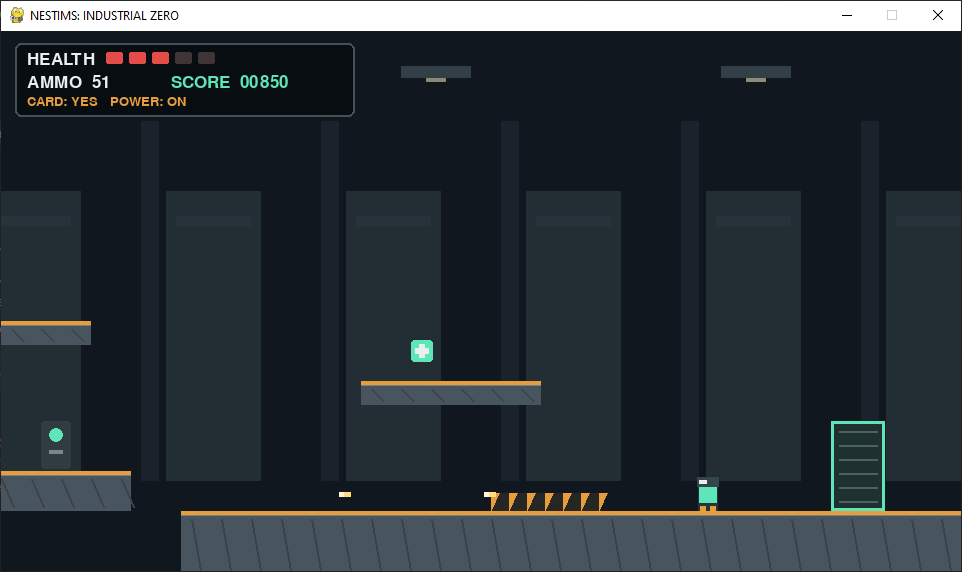
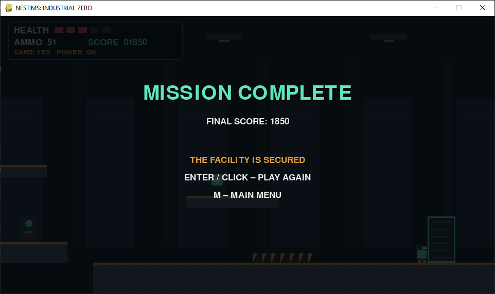
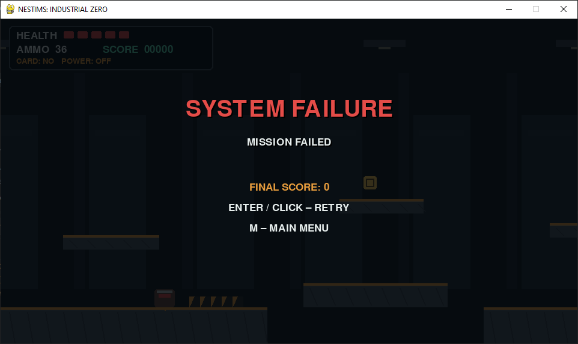

# Industrial Zero (Hunter Mike)

> A 2D industrial platformer inspired by Dangerous Dave (1991).

| Project Information | Details |
|---|---|
| Project ID | NS-006 |
| Direction | Games |
| Development Phase | Phase I |
| Version | v1.0.0 |
| Platform | Windows / Python |
| Status | Completed |

> 

## 📖 Overview

Explore an industrial facility, navigate platforms, collect a keycard, restore power and reach the exit.

## ✨ Features

- Platform movement and jumping

- Industrial level with obstacles

- Keycard and power objectives

- Mission scoring and restart menu

## 🛠 Technology Stack

- Python
- Pygame

## 📦 Installation

- Download the Windows executable from Releases: [more...](https://github.com/NebulaStack-prog/Hunter-Mike/releases/tag/v1.0.0)

- Or run with Python original source code: [more...](Industrial_Zero.py)

## 📊 Project Status

A completed NESTIMS Phase I project.

## 📷 Screenshots

© NESTIMS
